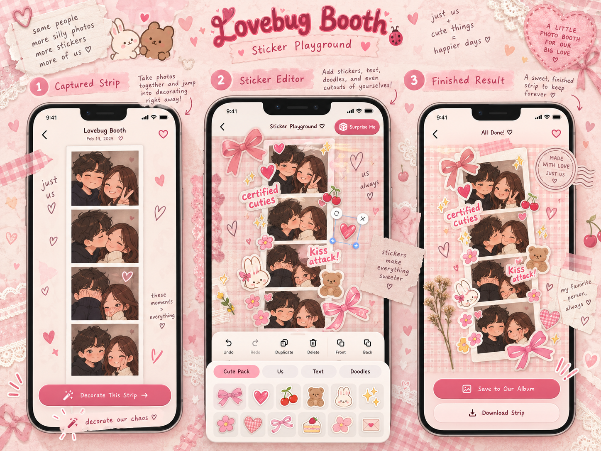

# Lovebug Booth ♡

**Four photos. Two lovebugs. So many stickers.**

A playful, mobile-first couples photo booth. This is a personal project, not a business: open the booth, take or upload four pictures, decorate the strip with handmade stickers and cutouts, and save your little moments.



> The concept illustration is a design reference. The actual UI uses responsive HTML/CSS and an interactive Canvas editor, rather than a flattened screenshot.

### v0.5.4 — Daily Health & Keep-Alive (optional infrastructure)

Two independent schedulers (GitHub Actions + your external cron) call a **token-protected Supabase Edge Function** to record a UTC daily heartbeat and Vercel site reachability. This does **not** upload photos or change the booth UI. The public `keep_alive_log` security finding is resolved by enabling RLS and revoking browser access; only the server-side function writes the table. **Deployment, two private tokens, and the SQL migration are required before using the endpoint.** See [Daily Health & Keep-Alive](docs/DAILY_HEALTH_KEEPALIVE.md). Scheduled activity does not guarantee that a Free Supabase project will never pause.

### v0.5 Secure Together Apart (guest-first)

Live rooms are now **unlisted and server-authorized**: choose a **Quick Room** (link + host approval) or **Locked Room** (link + six-digit PIN + approval). The guest's camera remains off before host approval. Supabase anonymous authentication is used behind the scenes, **not a Google sign-in requirement**. Two participants maximum, 45-minute room expiry, private Realtime signaling protected by server-enforced RLS. No gallery of public rooms and no automatic photo upload.

**Required setup:** [Secure Live Rooms](docs/SECURE_LIVE_ROOMS.md). Run `supabase/migrations/20261012_002_secure_live_rooms.sql`, enable anonymous sign-ins, disable public Realtime channel access, then deploy. Existing unprotected v0.4 invitations will not work on v0.5.

### v0.5.1 Together after the photo (shared + individual editing)

After four Live Together photos, both participants can choose **Decorate together** (mutual consent, shared stickers/doodles/crops through peer-to-peer WebRTC) or **Make my own version** (private local edits). Captured photos are transferred directly from the host so shared editors use matching images. The host no longer closes the entire room by visiting Sticker Playground; either person can finish, save, download or share independently. The **Adjust our photo** button receives a brief, accessible hint after both cameras connect.

No new database tables or cloud photo uploads. See [Collaborative Editing](docs/COLLABORATIVE_EDITING.md) for the data-flow, 45-minute expiration behavior, two-device checks, and offline fallback. **Both participants need the same v0.5.1 version after deployment.**

## Get started (Windows PowerShell)

Prerequisites: Node.js 22.12+ or 24+, npm, Git. The versions you already have (Node 24.16, npm 11.5.2) are suitable.

```powershell
# In your local clone of https://github.com/Shadhujan/lovebug-booth
npm install
npm run dev
```

Open `http://localhost:5173` on your laptop. **Try the illustrated demo first** to test the editor without granting camera permission.

### v0.4.1 - Local-first memories (current public behavior)

- Use the normal photo booth, Photo Letters, Sticker Playground, and local album without signing in.
- Finished strips save to this browser via IndexedDB, not to the cloud.
- Our Little Album offers an explicit **download all memories** ZIP containing saved strip PNGs, handmade stickers, a metadata file and a README. The ZIP is generated entirely in the browser. It is an export, not a one-click restore/import feature.
- **Clear saved memories** requires a second confirmation and removes browser-saved strips and handmade stickers together. Neither action removes anything in an existing Supabase project.
- The v0.4 Supabase shared-album code is retained but **not rendered**. Do not expose the current single-couple SQL schema to public users: future cloud backups require properly isolated albums for every account/couple.
- As of v0.5, Live Together uses anonymous guest sessions, host approval, and private Realtime signaling. Follow `docs/SECURE_LIVE_ROOMS.md` for the server setup and its security limitations.
- Clearing browser data or changing phones can erase local memories. Download important photos or export your album backup.

### Together Apart v0.3 (shared virtual worlds)

**New:** choose a Flower garden, Little café, Sunset beach, or Moonlight rooftop. A lazy-loaded MediaPipe selfie segmenter cuts *both* people from the original camera feeds and places them into one shared scene on the device. The existing full-size preview is preserved. Both phones wait for cutout readiness before live capture; Photo Letters can use the same scenes offline from your partner. Original cameras is always available as a reliable fallback. **See [Shared virtual backgrounds](docs/SHARED_VIRTUAL_BACKGROUNDS.md) for setup, privacy limits, and phone tests.**

Add the vision package after applying the patch with `npm install` and commit the updated `package-lock.json` before pushing to production.

### Together Apart v0.2.1 (framing update)

Two ways to make pictures together while far away:

- **Live Together (experimental):** two camera feeds in a temporary invite-link room using WebRTC and Supabase Realtime. A single finished-photo preview shows the same crop, blending, mirroring and scrapbook border used in the four captured images. The host can choose Closer Together, Balanced or Classic Split, flip either saved photo, and shift the framing.
- **Photo Letters:** independent four-photo captures, portable private `.json` photo packs, an editable preview and the same blending/flip/framing modes as live capture, then the normal sticker editor.

Historical v0.2 notes: soft blending joins full camera frames without a hard gutter. Newer versions also support local person cutouts and illustrated scenes. The old public, unauthenticated v0.2 rooms are superseded by the server-authorized v0.5 flow. See [Secure Live Rooms](docs/SECURE_LIVE_ROOMS.md).

### Features in v0.1

- Responsive scrapbook-style homepage and navigation, designed for mobile touch.
- Four original photo-strip themes and a funny pose roulette.
- Browser camera capture with per-shot countdown (3, 5, or 10 seconds), review, retake, and photo uploads.
- Original, illustrated demo photos so you can explore without a camera.
- Canvas-based drag-and-drop sticker playground; resize and rotate handles, touch pinch gestures, duplicate, delete, layer order, undo/redo.
- Fourteen original SVG stickers, plus text stickers and handwritten captions.
- Doodle mode with brush colors and sizes; five photo looks (including black and white).
- Custom sticker maker: import your own picture, shape cutout (circle, heart, rounded, original), optional *simple plain-color background remover*, and a persistent local sticker box.
- High-quality PNG downloads, final result screen, and an album that saves photos in this browser with IndexedDB.
- No account required, no trackers, and no automatic cloud upload.

### Important privacy details

- **The album is local-only in v0.1.** Saving on your laptop does **not** make it available on her phone. Browser data clearing or changing browsers can remove the album; download anything you care about.
- The supplied custom background remover is based on edge colors; it is **not an AI model** and may be inaccurate with busy photo backgrounds. Circle/heart shaped cutouts always work.
- Browser camera access is supported on `localhost` or an HTTPS website. On another device over plain `http://192.168.x.x`, you can browse/use photo uploads but camera access may be unavailable.
- This repository is currently public: **never commit personal photos, real keys, local `.env` files, or tokens.** The demo illustrations and sticker art are original.
- No third-party Pinterest images are shipped. Pinterest was used as visual inspiration, not a source of unlicensed assets.

### Tech stack

- React 19 + TypeScript + Vite 7
- Small handcrafted responsive CSS stylesheet (no large CSS framework required)
- Browser Camera API, Canvas 2D, Pointer Events, IndexedDB, PNG export
- Static deployment compatible with Cloudflare Pages / Netlify / Vercel
- Supabase Realtime is optional in v0.2 for signaling temporary live rooms; private two-person login and shared album with RLS + private Storage remain future work. No secret keys belong in frontend files.

### Scripts

```powershell
npm run dev          # local development
npm run typecheck    # TypeScript validation
npm run build        # production static site to dist/
npm run preview      # preview the build
```

### Deployment (when ready for her phone)

Use a static host that provides HTTPS, such as Cloudflare Pages. Connect your GitHub repo and configure:

| Setting | Value |
| --- | --- |
| Framework | Vite |
| Build command | `npm run build` |
| Output directory | `dist` |

Visit the generated HTTPS URL on her phone. The app is mobile-responsive. Live Together also needs your publishable Supabase variables configured for the Pages deployment. For a shared cloud album, complete the separate Auth/Storage integration later; until then, use **Download Strip** and share the PNG yourself.

### Together Apart adjustment panel (v0.2.2)

The big combined photo stays at the same size. Wide desktop screens show photo controls in a scrollable inspector beside it; phones and smaller screens offer an **adjust our photo** button that opens a bottom drawer with a miniature live composition. The shutter button is beside the photo rather than below all settings. See [Together Apart setup](docs/TOGETHER_APART_SETUP.md#v022-adjustments-while-viewing-the-photo).

### Supabase project

The original solo booth and Photo Letters work without Supabase. Live Together requires **Supabase Realtime, anonymous guest Auth, and v0.5 room RLS/RPC migration**, plus the existing Project URL and publishable key in `.env.local` or Vercel. Do not commit that local file. Cloud albums stay hidden until a future multi-user rollout. [Full setup guide](docs/SECURE_LIVE_ROOMS.md).

### Code layout

```text
src/
  components/        # Each interactive screen + custom cutout editor
  lib/canvas.ts      # Strip composition and sticker rendering
  lib/cutout.ts      # Browser-only shape/background cutout processing
  lib/photos.ts      # Capture and photo compression
  lib/togetherPhotos.ts  # Photo Letters and side-by-side composition
  lib/storage.ts     # IndexedDB local album and sticker box
  lib/themes.ts      # Frame themes, pose prompts and sticker catalog
  types.ts           # Domain types
  styles.css         # Responsive art direction
public/
  stickers/           # Original, reusable SVG sticker pack
  demo/               # Original placeholder portraits
  favicon.svg
  manifest.webmanifest
```

See [Milestones](docs/MILESTONES.md) for the feature roadmap.

---

Made for two people and their silly little moments. ♡

### v0.3.4 — A background that's ours ♡

In Live Together, **both lovebugs** can adjust the shared composition and
countdown. The most recent edit wins. Either person can choose **Our own photo**
and upload a background (JPEG, PNG or WebP, up to 10 MB); it travels only through
the existing WebRTC data channel and is not saved to Supabase. The host still
starts the actual four-photo countdown. Personal backgrounds can also be used
in Photo Letters. See [shared backgrounds](docs/SHARED_VIRTUAL_BACKGROUNDS.md).

### v0.3.5: Photo improvements

The solo camera marks the **actual film-strip crop** before capture, and the Review step lets you reframe any shot vertically before decorating. The Doodles palette supports an eraser that only removes doodle paths. Photo Letters previews each of four pairs and allows per-pair adjustment or replacement. Solo and Live Together cameras have an optional **screen** flash; in Live Together each lovebug chooses independently on their own device (default off). This does not turn on the hardware LED flash.

### v0.3.6 - move your photos directly

On the review screen, drag any captured photo within its exact final strip crop. Pinch on a phone, scroll over the photo on desktop, or use the + and - buttons to zoom. The reset button centers only that photo. Keyboard users can focus the preview and use arrow keys, +, -, and 0. Preview and export share the same Canvas crop calculations, so the final strip matches the edited framing. Retaking/replacing a shot resets only that shot's crop.


### v0.4 - Our shared private album

Historical v0.4 code: a single-couple opt-in shared album was prototyped with Supabase Auth/RLS/Storage, but its UI was deliberately **hidden in v0.4.1** pending a multi-user privacy redesign. Local photos never upload automatically. For the current secure Live Together rooms, see [Secure Live Rooms](docs/SECURE_LIVE_ROOMS.md).


### v0.6.2: Simple albums and room recovery

See [Room recovery and simple albums](docs/CLOUD_ALBUM_V062_AND_ROOM_RECOVERY.md) for the non-destructive SQL migration, protected whole-album deletion endpoint, and mandatory two-device regression checklist.
